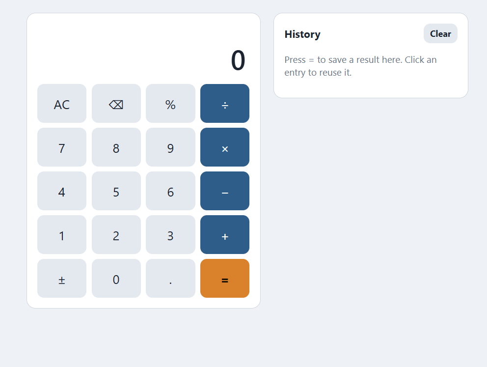

# js-calculator
- Add, subtract, multiply, and divide, with chained operations
- AC, backspace, ±, and %
- A “Can’t divide by zero” message instead of crashing
- A history panel (last 10 results) where clicking an entry reuses the result
- Dark and light modes that follow your system

